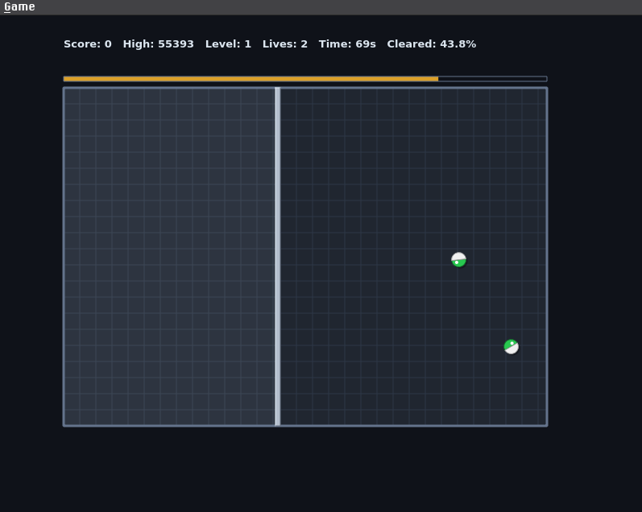

# Flingball

A modern, polished clone of the classic arcade game *Jezzball*, built from scratch for Linux using **C++**, **CMake**, and **Qt6**.



## Features

- **Classic Mechanics:** Slice the play arena into smaller rooms while dodging bouncing atoms to clear at least 75% of the board.
- **Dynamic Scaling:** Level 1 starts with 2 atoms and scales up by +1 each level, capping at 50 atoms from Level 49 onward for an endless high-score challenge.
- **Half-Wall Survival:** Expanding walls are vulnerable while building. If an atom strikes one half of your expanding line, that half fails, but a successfully anchored half still hardens into a permanent obstacle!
- **Scoring & Bonuses:** Earn points based on cleared area percentage, remaining level time, and leftover lives.
- **Persistent High Scores:** Local high scores are automatically saved using `QSettings`.
- **Procedural Audio:** Automatically generates retro arcade bounce sound effects on launch with zero external asset dependencies.

## Tech Stack

- **Language:** C++17
- **Build System:** CMake
- **Framework:** Qt6 (Core, Gui, Widgets, Multimedia)

## Building and Running on Arch Linux

Ensure you have Qt6 and CMake installed:

```bash
sudo pacman -S qt6-base qt6-multimedia cmake make gcc
```

Build and run the project:

```bash
mkdir build
cd build
cmake ..
make
./jezzball-qt
```

## Controls

- **Left-Click:** Build a wall in the active room from your cursor position.
- **Right-Click / Spacebar:** Toggle wall orientation between Horizontal and Vertical.
- **F2:** Start a new game.